# Veritabanı ER Diyagramı

Kaynak şema: `apps/api/prisma/schema.prisma` (tek doğruluk kaynağı). Aşağıdaki diyagram Mermaid formatındadır; GitHub ve çoğu Markdown görüntüleyici otomatik çizer.

## Özet ilişkiler

```mermaid
erDiagram
  Organization ||--o{ User : "kullanıcılar"
  Organization ||--o{ Role : "roller"
  Role ||--o{ RolePermission : ""
  Permission ||--o{ RolePermission : ""
  User ||--o{ UserRole : ""
  Role ||--o{ UserRole : ""

  Organization ||--o{ ChannelAccount : "bağlı hesaplar"
  SalesChannel ||--o{ ChannelAccount : "kanal türü"
  ChannelAccount ||--o| ChannelStockPolicy : "stok politikası"
  ChannelAccount ||--o{ ChannelCategory : "kanal kategorileri"

  Organization ||--o{ Category : "iç kategori"
  Category ||--o{ Category : "alt kategori"
  Category ||--o{ CategoryMapping : ""
  ChannelCategory ||--o{ CategoryMapping : ""

  Organization ||--o{ Product : "ürünler"
  Category ||--o{ Product : ""
  Product ||--|{ ProductVariant : "varyantlar (SKU)"
  Product ||--o{ ProductAttribute : ""
  Product ||--o{ ProductImage : ""
  ProductVariant ||--o{ ProductImage : ""

  ProductVariant ||--o{ Listing : "kanal ilanları"
  ChannelAccount ||--o{ Listing : ""
  Listing ||--o{ ListingMatchSuggestion : "eşleştirme önerisi"
  Listing ||--o{ ListingSyncJob : ""
  ChannelAccount ||--o{ ListingSyncJob : ""

  Organization ||--o{ Warehouse : "depolar"
  Warehouse ||--o{ InventoryBalance : ""
  ProductVariant ||--o{ InventoryBalance : ""
  Warehouse ||--o{ InventoryMovement : "hareket defteri"
  ProductVariant ||--o{ InventoryMovement : ""

  ChannelAccount ||--o{ Order : "siparişler"
  Order ||--|{ OrderItem : ""
  ProductVariant ||--o{ OrderItem : ""
  Order ||--o{ Shipment : "kargo"
  Order ||--o{ Return : "iade"
  Order ||--o{ OrderStatusHistory : ""

  Organization ||--o{ PricingRule : ""
  ChannelAccount ||--o{ PricingRule : ""

  ChannelAccount ||--o{ AdvertisingCampaign : "reklam"
  AdvertisingCampaign ||--o{ AdvertisingMetric : "günlük metrik"
  ProductVariant ||--o{ AdvertisingMetric : ""

  ChannelAccount ||--o{ CustomerQuestion : "sorular"
  Product ||--o{ CustomerQuestion : ""
  User ||--o{ CustomerQuestion : "atanan"
  CustomerQuestion ||--o{ QuestionResponse : ""
  ChannelAccount ||--o{ ProductReview : "yorumlar"
  Product ||--o{ ProductReview : ""
  ProductReview ||--o{ ReviewResponse : ""

  Organization ||--o{ AIRequest : ""
  Organization ||--o{ AutomationRule : ""
  Organization ||--o{ Notification : ""
  Organization ||--o{ AuditLog : ""
  User ||--o| DashboardLayout : ""
```

## Kritik tasarım kararları

| Karar | Gerekçe |
|---|---|
| `Product` ↔ `Listing` ayrımı | Aynı ürün her kanalda farklı başlık/fiyat/açıklama taşır; kanal ilanı silinse merkezi ürün kalır. |
| `ProductVariant` satılabilir birim | Barkod, SKU, fiyat, stok varyant düzeyindedir; varyantsız ürün tek varyanta sahiptir. Tüm sipariş kalemleri ve stok bu tabloya bağlanır. |
| `Listing.variantId` null olabilir | Pazaryerinden içe aktarılan ürün otomatik birleştirilmez; `ListingMatchSuggestion` ile öneri sunulur, kullanıcı onaylar. |
| `InventoryMovement` benzersiz `(referenceKey, type)` | Aynı sipariş için çift stok düşümünü veritabanı engeller. |
| `Order` benzersiz `(channelAccountId, externalId)` | Aynı sipariş tekrar çekilince güncellenir, kopyalanmaz. |
| `ChannelAccount.credentialsEnc` | API anahtarları yalnızca şifreli saklanır; düz metin sütun yoktur. |
| `isDemo` bayrakları | Demo ürün/sipariş/hesap gerçek veriden ayrılır; raporlar `isDemo=false` filtresiyle çalışır. |
| `rawSnapshot` (Json) | Kanaldan gelen ham veri saklanır; alan eşleştirme hatası fark edilirse geriye dönük düzeltilebilir. |
| `AIRequest` maliyet alanları | Her AI çağrısının token ve dolar maliyeti izlenir. |

## İndeksler (özet)

- Arama: `ProductVariant.sku`, `ProductVariant.barcode`, `Product(organizationId, brand)`
- Operasyon: `Order(organizationId, status, orderedAt)`, `ListingSyncJob(channelAccountId, status, createdAt)`
- Destek: `CustomerQuestion(organizationId, status, askedAt)`, `ProductReview(organizationId, rating, reviewedAt)`
- Denetim: `AuditLog(organizationId, createdAt)`, `AuditLog(entityType, entityId)`
